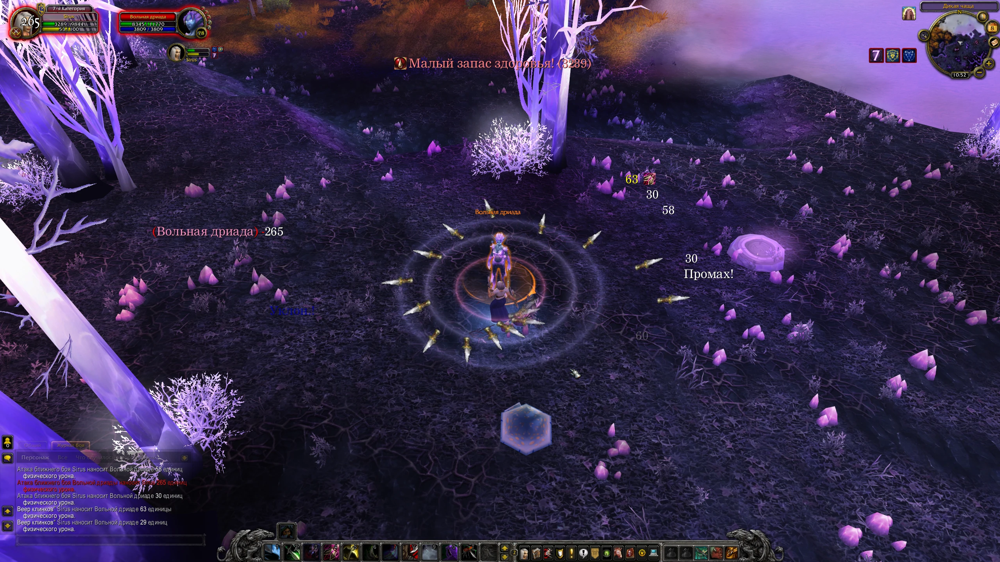
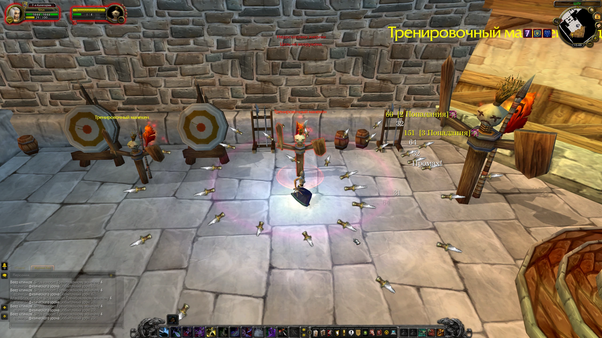
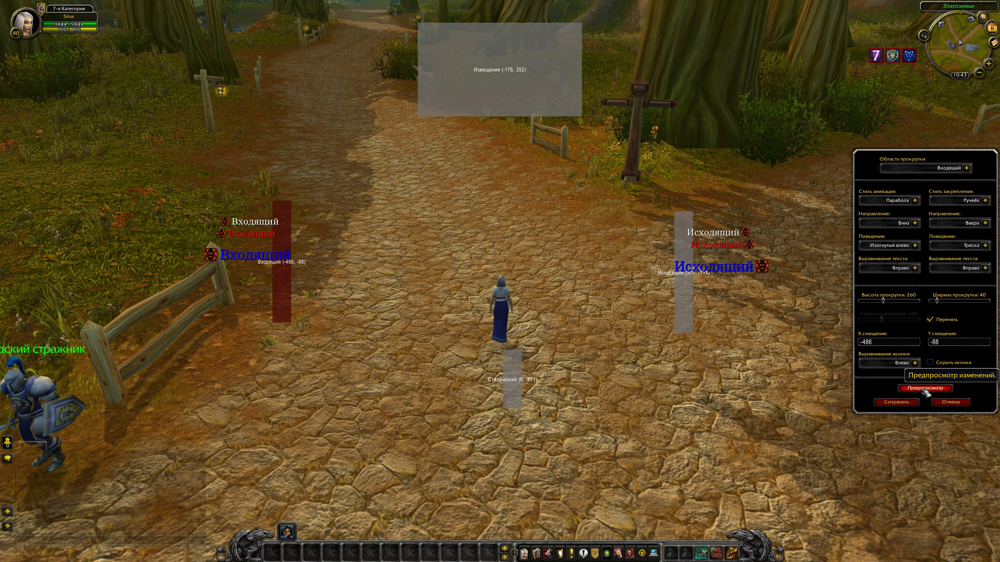
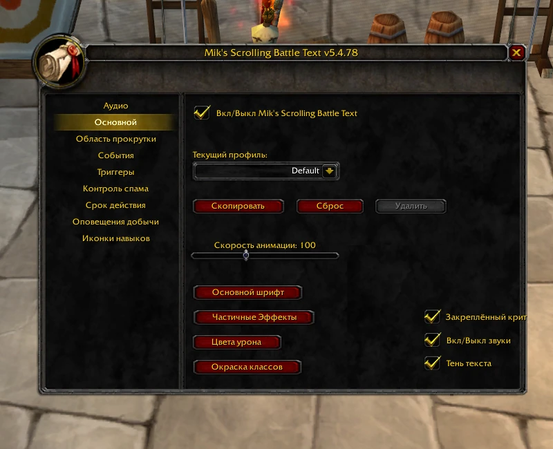
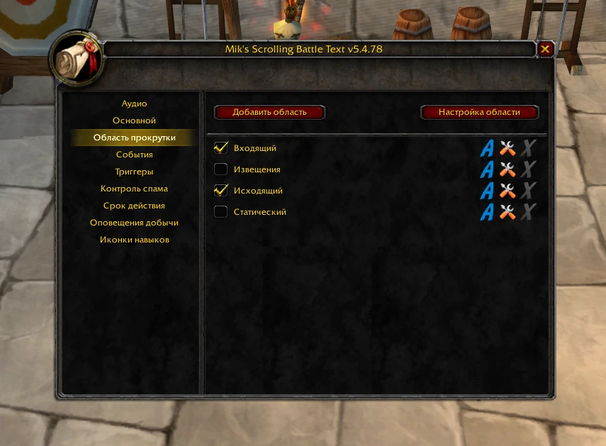
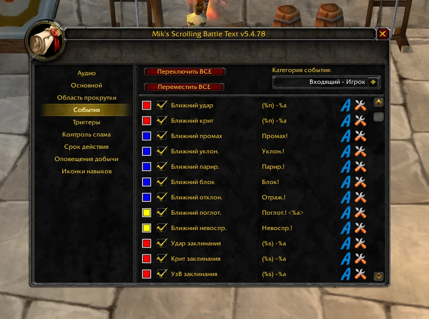
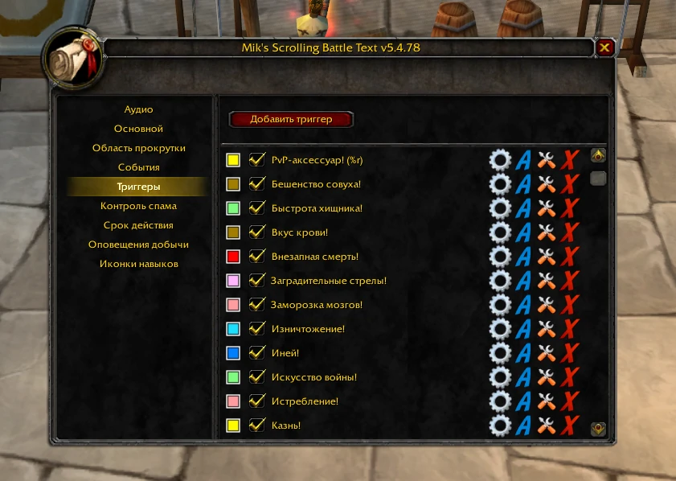
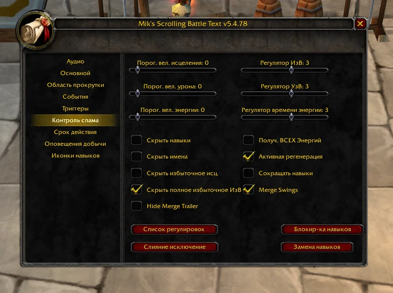

MikScrollingBattleText (MSBT) — заменит стандартный близзардовский всплывающий текст (урон, репутация и т.д.).

Большое количество шрифтов;  
Крутая анимация всплывающего текста;  
Отображения входящих и исходящих заклинаний;  
Аддон не грузит интерфейс;  
Простая настройка. Аддон прост в настройке, можно изменить все (шрифт, размер, звук, анимацию).

/msbt — открывает окно настроек;  
/msbt reset — сбрасывает ваши настройки;

**Скриншоты:**

